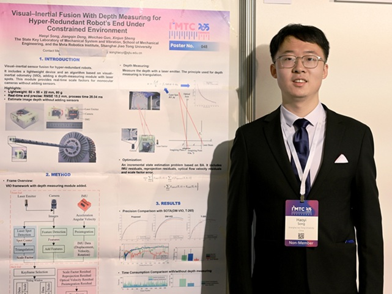
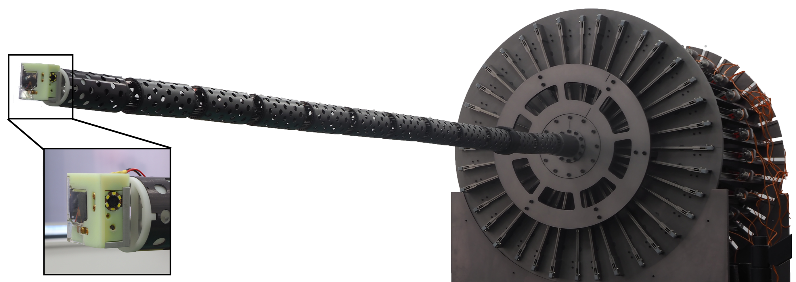
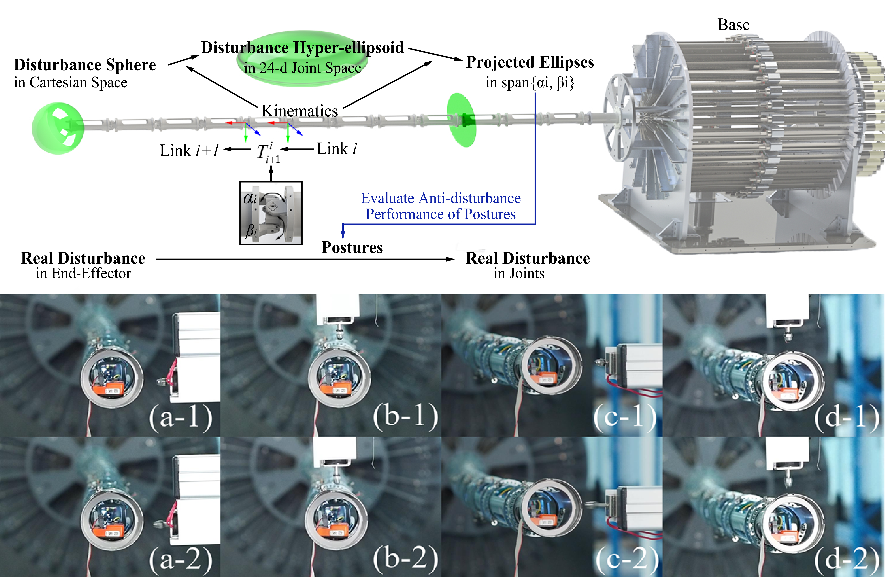
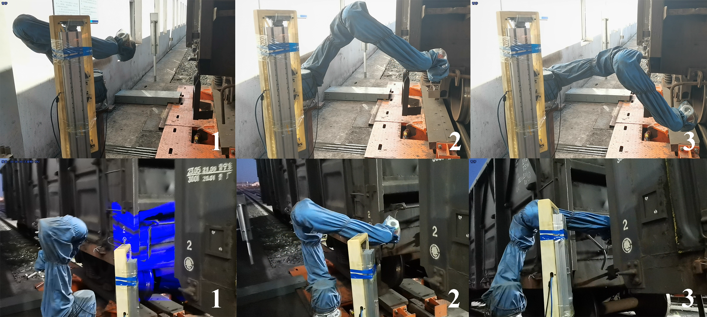
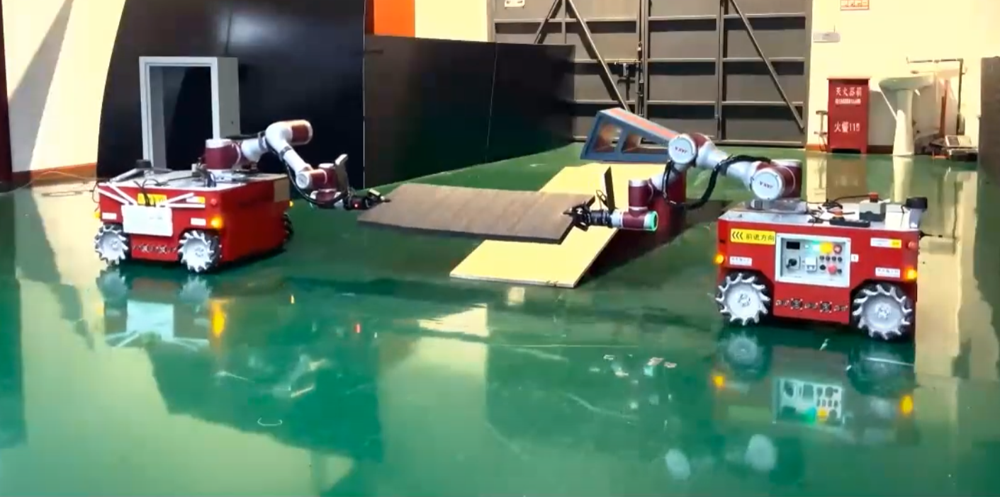
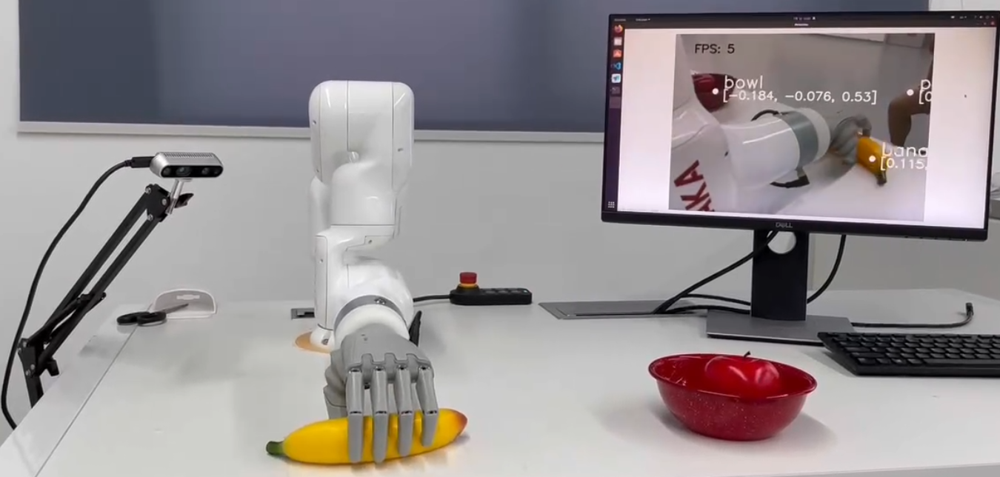
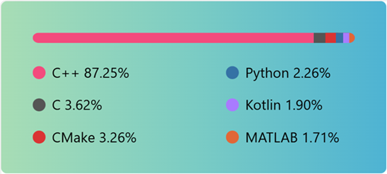

<a href="./README.md"><kbd>　简体中文　↗　</kbd></a>

# Haoyi Song

I am a PhD student at Shanghai Jiao Tong University, where I study how to improve the positioning accuracy of hyper-redundant robots. I am an IEEE Student Member and contributed to the university’s *Design and Manufacturing* (《设计与制造》) textbook.

[songhaoyi@sjtu.edu.cn](mailto:songhaoyi@sjtu.edu.cn) · Amateur radio callsign [BH4HIE](https://www.qrz.com/db/BH4HIE)

 

[Education](#education) · [Research projects](#research-projects) · [Publications and patents](#publications-and-patents) · [GitHub](#github)

## Education

-  **Shanghai Jiao Tong University** · PhD student  
  September 2020 – December 2026 (expected) · Shanghai  
  Institute of Robotics, School of Mechanical Engineering. Advised by [Prof. Xinjun Sheng](https://me.sjtu.edu.cn/teacher_directory1/shengxinjun.html).
-  **Southeast University** · Bachelor’s degree  
  September 2016 – June 2020 · Nanjing  
  School of Mechanical Engineering.

## Research projects

<table>
  <thead>
    <tr><th>Project and preview</th><th>Method and resources</th></tr>
  </thead>
  <tbody>
    <tr>
      <td valign="top"><strong>Learning to compensate for robot motion errors</strong> <em>Ongoing</em></td>
      <td valign="top">A deep residual network learns the difference between the motion predicted by a kinematic model and the measured motion of a hyper-redundant robot. The controller uses this estimate to compensate for motion errors.  
        <strong>Tools</strong> · ONNX, Python, MATLAB, Qt 
        <a href="https://github.com/Haoyi-SJTU/cdhm_controller"><code>CDHM</code></a>
      </td>
    </tr>
    <tr>
      <td valign="top"><strong>End-effector localization in confined spaces</strong>  
        
      </td>
      <td valign="top">Visual–inertial odometry and depth estimates from monocular images track the position of a hyper-redundant robot’s end effector in confined spaces.  
        <strong>Tools</strong> · IMU, cameras, C++, ROS, OpenCV, PCL, Gurobi 
        <a href="https://ieeexplore.ieee.org/document/10619992">Paper</a> · <a href="https://www.youtube.com/watch?v=FsOk0mO07QY">Video</a> · <a href="https://github.com/Haoyi-SJTU/lvi"><code>lvi</code></a>
      </td>
    </tr>
    <tr>
      <td valign="top"><strong>Disturbance resistance in hyper-redundant robots</strong>  
        
      </td>
      <td valign="top">A disturbance hyper-ellipsoid derived from the robot’s kinematics quantifies its sensitivity to disturbances.  
        <strong>Tools</strong> · C++, MATLAB, Gurobi, CoppeliaSim, MuJoCo 
        <a href="https://doi.org/10.1007/s12555-026-00144-0">Paper</a> · <a href="https://youtu.be/LZfitKhQ1Bw">Video</a> · <a href="https://github.com/Haoyi-SJTU/DHE"><code>DHE</code></a>
      </td>
    </tr>
    <tr>
      <td valign="top"><strong>Train coupler recognition outdoors</strong>  
        
      </td>
      <td valign="top">An improved genetic algorithm fits a cylinder to structured-light camera data to identify a train coupler in a complex outdoor scene.  
        <strong>Tools</strong> · Structured-light camera, C++, Python, PCL, Open3D 
        <a href="https://ieeexplore.ieee.org/document/9665109">Paper</a> · <a href="https://www.bilibili.com/video/BV1ZRtRz3E1A/">Video</a> · <a href="https://github.com/Haoyi-SJTU/jaka_zu12_description"><code>jaka_zu12_description</code></a>
      </td>
    </tr>
    <tr>
      <td valign="top"><strong>Cooperative transport with mobile manipulators</strong>  
        
      </td>
      <td valign="top">A ROS communication framework collects and shares data from multiple sensor types across robots, giving mobile manipulators the perception data they need to transport a load together.  
        <strong>Tools</strong> · C++, ROS 
        <a href="https://www.cambridge.org/core/journals/robotica/article/abs/novel-semicoupled-hierarchical-motion-planning-framework-for-cooperative-transportation-of-multiple-mobile-manipulators/25FA5B8B64030267388C0161E9E9CD03">Paper</a> · <a href="https://www.youtube.com/watch?v=Y8ZrnspIuBg">Video</a> · <a href="https://github.com/Haoyi-SJTU/jaka_velocity"><code>jaka_velocity</code></a> · <a href="https://github.com/Haoyi-SJTU/apriltag"><code>apriltag_modified</code></a>
      </td>
    </tr>
    <tr>
      <td valign="top"><strong>Hand–arm coordination for grasping</strong>  
        
      </td>
      <td valign="top">An external RGB-D camera locates objects for a six-axis robot arm fitted with a humanoid hand. The system was developed for JAKA demonstrations.  
        <strong>Tools</strong> · C++, ROS, OpenCV, YOLOv5 
        <a href="https://youtu.be/w6cCVBafOrc">Video</a> · <a href="https://github.com/Haoyi-SJTU/jaka_show"><code>jaka_show</code></a> · <a href="https://github.com/Haoyi-SJTU/jaka_description"><code>jaka_description</code></a>
      </td>
    </tr>
  </tbody>
</table>

## Publications and patents

### Papers

1. **H. Song**, J. Deng, W. Guo and X. Sheng. [Visual–Inertial Fusion With Depth Measuring for Hyper-Redundant Robot’s End Under Constrained Environment](https://ieeexplore.ieee.org/document/10619992). *IEEE Transactions on Instrumentation and Measurement* (TIM) · IEEE International Instrumentation and Measurement Technology Conference (I2MTC 2025).
2. **H. Song**, Z. Zhu, Z. Peng, W. Guo, C. Liu, Y. Li and X. Sheng. [Disturbance Hyper-ellipsoid: A Metric for Evaluating Disturbance Resistance of Hyper-redundant Robots](https://doi.org/10.1007/s12555-026-00144-0). *International Journal of Control, Automation, and Systems*, 24, 2408–2421 (2026).
3. **H. Song**, W. Guo, C. Liu and X. Sheng. A Physics-Informed World Model for Cable-Length Residual Prediction in Cable-Driven Robots. *2026 IEEE International Conference on Robotics and Biomimetics* (ROBIO).
4. **H. Song**, Z. Chai, X. Sheng, Z. Xiong and X. Zhu. [Cylinder Fitting of Coupler Using an Improved Genetic Algorithm](https://ieeexplore.ieee.org/document/9665109). *IEEE International Conference on Mechatronics and Machine Vision in Practice* (M2VIP 2021).
5. H. Zhang, **H. Song**, W. Liu, Z. Xiong and X. Zhu. [A Novel Semi-Coupled Hierarchical Motion Planning Framework for Cooperative Transportation of Multiple Mobile Manipulators](https://www.cambridge.org/core/journals/robotica/article/abs/novel-semicoupled-hierarchical-motion-planning-framework-for-cooperative-transportation-of-multiple-mobile-manipulators/25FA5B8B64030267388C0161E9E9CD03). *Robotica*.
6. **H. Song**, J. Shi, C. Liu, W. Guo and X. Sheng. Physics-Informed Learning for Cable Residual Compensation in Cable-Driven Robots. *IEEE Robotics and Automation Letters* (under review).

### Granted patents

1. [Steering adjustment mechanism for a carbon-free vehicle](https://patents.google.com/patent/CN110102068B/en) · `ZL201910398073.3` · **H. Song**, Y. Ding, Y. Wang and H. Luo.
2. [Ball screw with a self-locking mechanism](https://patents.google.com/patent/CN110388430B/en) · `ZL201910699568.X` · **H. Song** and R. Qian.
3. [Quick-mount sensor mechanism for a hyper-redundant snake-like manipulator](https://patents.google.com/patent/CN116277154B/en) · `ZL202310301008.0` · X. Sheng, **H. Song** and W. Guo.
4. [Industrial camera gimbal with protection against dust and machining chips](https://patents.google.com/patent/CN114995027B/en) · `ZL202210752423.3` · T. Zhou, Z. Xiong, M. Tao, **H. Song**, L. Zhang, Y. Mei and Y. Yang.

## GitHub

  

  <a href="https://github.com/Haoyi-SJTU?tab=repositories">All repositories</a> ·
  <a href="https://github.com/Haoyi-SJTU?tab=repositories&amp;language=c%2B%2B">C++</a> ·
  <a href="https://github.com/Haoyi-SJTU?tab=repositories&amp;language=matlab">MATLAB</a> ·
  <a href="https://github.com/Haoyi-SJTU?tab=repositories&amp;language=python">Python</a>

---

<em>越过高山，越过平原，跨过奔腾的黄河长江</em>

