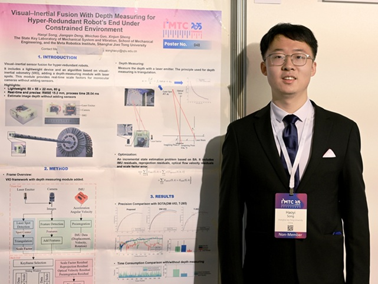
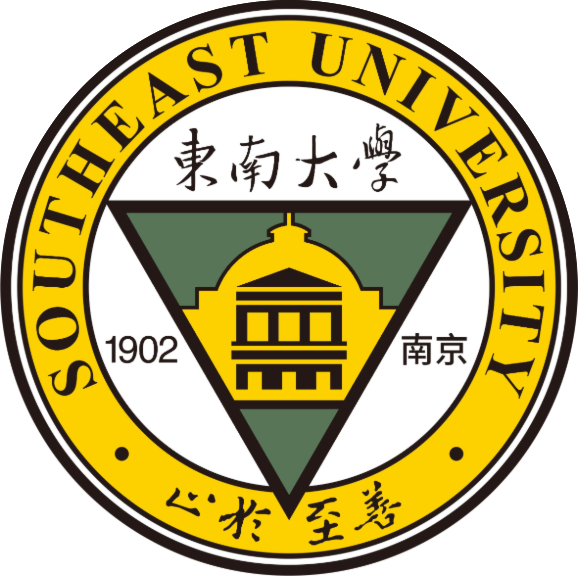
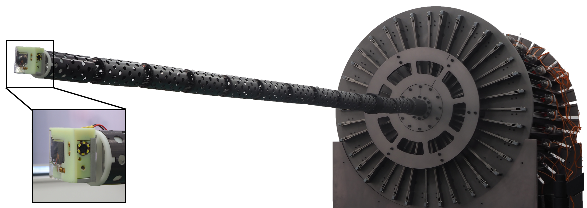
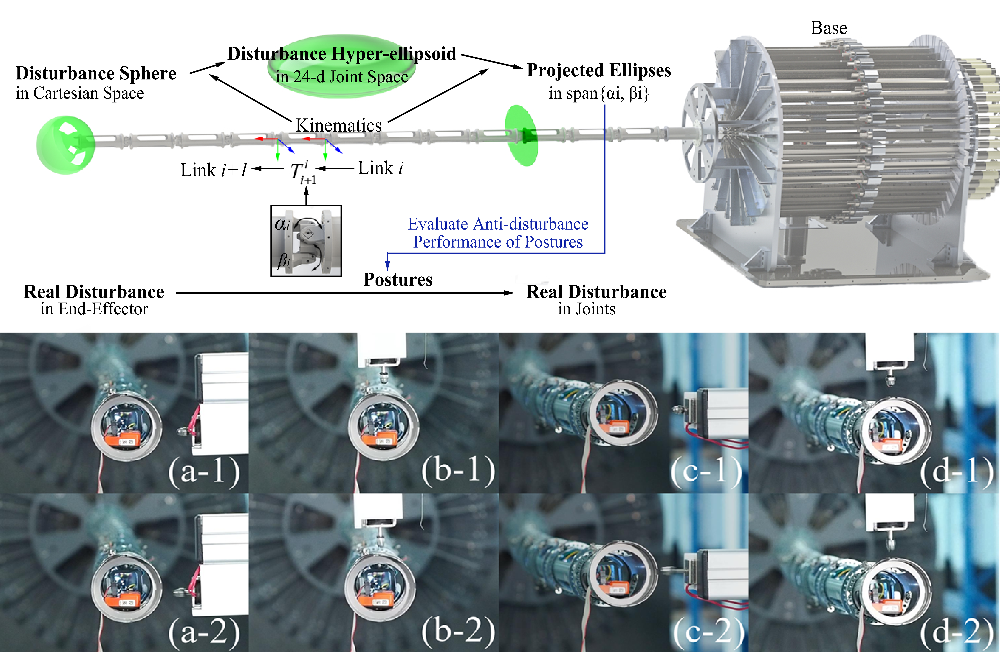
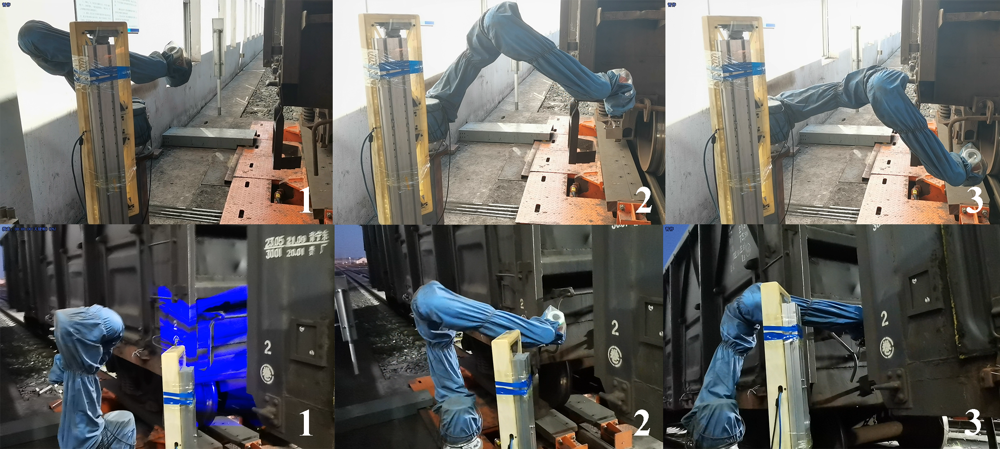
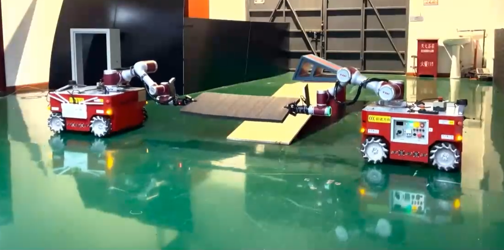
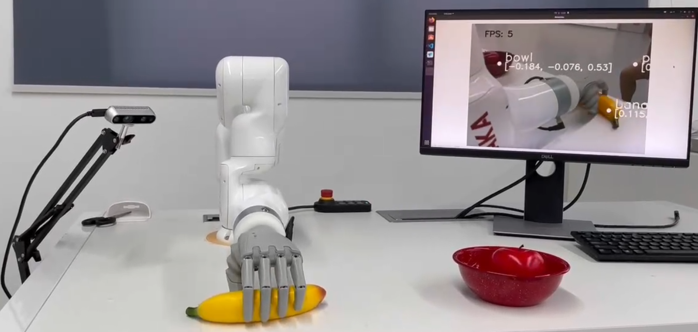

<a href="./README.en.md"><kbd>　English　↗　</kbd></a>

# 宋浩艺 · Haoyi Song

上海交通大学机器人研究所博士研究生，IEEE 学生会员。

研究聚焦于超冗余机器人的运动精度：如何在受限空间中测准末端位置，如何评估外部扰动的影响，以及如何利用学习模型补偿运动误差。参与编写《设计与制造》课程教材。

[电子邮箱 · songhaoyi@sjtu.edu.cn](mailto:songhaoyi@sjtu.edu.cn)　·　[业余无线电呼号 · BH4HIE](https://www.qrz.com/db/BH4HIE)

 

[教育经历](#教育经历)　·　[研究项目](#研究项目)　·　[论文与专利](#论文与专利)　·　[GitHub](#github)

## 教育经历

-  **上海交通大学** · 机械与动力工程学院机器人研究所  
  博士研究生 · 上海 · 2020.09 — 2026.12（预计）  
  研究方向为超冗余机器人精度提升，导师为[盛鑫军教授](https://me.sjtu.edu.cn/teacher_directory1/shengxinjun.html)。
-  **东南大学** · 机械工程学院  
  本科 · 南京 · 2016.09 — 2020.06

## 研究项目

<table>
  <thead>
    <tr><th>项目与预览</th><th>研究方法与资源</th></tr>
  </thead>
  <tbody>
    <tr>
      <td valign="top"><strong>基于残差学习的机器人运动误差补偿</strong> <em>在研</em></td>
      <td valign="top">
        以运动学模型为基准，用深度残差网络学习模型预测与实测运动之间的偏差，补偿超冗余机器人的运动误差。  
        <strong>工具</strong>　ONNX、Python、MATLAB、Qt 
        <a href="https://github.com/Haoyi-SJTU/cdhm_controller">CDHM 源码</a>
      </td>
    </tr>
    <tr>
      <td valign="top"><strong>受限空间中的机器人末端精确定位</strong>  </td>
      <td valign="top">
        将单目深度估计引入视觉惯性里程计，融合相机与惯性测量单元的数据，估计超冗余机器人的末端位置。  
        <strong>工具</strong>　IMU、相机、C++、ROS、OpenCV、PCL、Gurobi 
        <a href="https://ieeexplore.ieee.org/document/10619992">论文</a> · <a href="https://www.youtube.com/watch?v=FsOk0mO07QY">演示视频</a> · <a href="https://github.com/Haoyi-SJTU/lvi">lvi 源码</a>
      </td>
    </tr>
    <tr>
      <td valign="top"><strong>超冗余机器人的抗扰性能分析</strong>  </td>
      <td valign="top">
        从机器人运动学出发，用扰动超椭球描述外部扰动向各关节的传递，量化不同构型下关节对扰动的敏感程度。  
        <strong>工具</strong>　C++、MATLAB、Gurobi、CoppeliaSim、MuJoCo 
        <a href="https://doi.org/10.1007/s12555-026-00144-0">论文</a> · <a href="https://youtu.be/LZfitKhQ1Bw">演示视频</a> · <a href="https://github.com/Haoyi-SJTU/DHE">DHE 源码</a>
      </td>
    </tr>
    <tr>
      <td valign="top"><strong>复杂环境中的列车车钩识别</strong>  </td>
      <td valign="top">
        用结构光相机采集点云，通过改进的遗传算法拟合车钩的圆柱特征，在复杂室外环境中识别车钩。  
        <strong>工具</strong>　结构光相机、C++、Python、PCL、Open3D 
        <a href="https://ieeexplore.ieee.org/document/9665109">论文</a> · <a href="https://www.bilibili.com/video/BV1ZRtRz3E1A/">演示视频</a> · <a href="https://github.com/Haoyi-SJTU/jaka_zu12_description">jaka_zu12_description 源码</a>
      </td>
    </tr>
    <tr>
      <td valign="top"><strong>多移动机械臂协同搬运</strong>  </td>
      <td valign="top">
        搭建基于 ROS 的多机器人通信框架，采集并共享多模态传感器数据，为协同搬运提供感知信息。  
        <strong>工具</strong>　C++、ROS 
        <a href="https://www.cambridge.org/core/journals/robotica/article/abs/novel-semicoupled-hierarchical-motion-planning-framework-for-cooperative-transportation-of-multiple-mobile-manipulators/25FA5B8B64030267388C0161E9E9CD03">论文</a> · <a href="https://www.youtube.com/watch?v=Y8ZrnspIuBg">演示视频</a> · <a href="https://github.com/Haoyi-SJTU/jaka_velocity">jaka_velocity</a> · <a href="https://github.com/Haoyi-SJTU/apriltag">apriltag_modified</a>
      </td>
    </tr>
    <tr>
      <td valign="top"><strong>仿人机械手与机械臂协同抓取</strong>  </td>
      <td valign="top">
        用外置 RGB-D 相机获取物体坐标，驱动六自由度机械臂与仿人机械手协同抓取，用于节卡机器人（JAKA）的对外演示。  
        <strong>工具</strong>　C++、ROS、OpenCV、YOLOv5 
        <a href="https://youtu.be/w6cCVBafOrc">演示视频</a> · <a href="https://github.com/Haoyi-SJTU/jaka_show">jaka_show</a> · <a href="https://github.com/Haoyi-SJTU/jaka_description">jaka_description</a>
      </td>
    </tr>
  </tbody>
</table>

## 论文与专利

### 学术论文

1. **H. Song**, J. Deng, W. Guo, X. Sheng. [Visual–Inertial Fusion With Depth Measuring for Hyper-Redundant Robot’s End Under Constrained Environment](https://ieeexplore.ieee.org/document/10619992). *IEEE Transactions on Instrumentation and Measurement* (TIM) · IEEE I2MTC 2025.
2. **H. Song**, Z. Zhu, Z. Peng, W. Guo, C. Liu, Y. Li, X. Sheng. [Disturbance Hyper-ellipsoid: A Metric for Evaluating Disturbance Resistance of Hyper-redundant Robots](https://doi.org/10.1007/s12555-026-00144-0). *International Journal of Control, Automation, and Systems*, 24, 2408–2421 (2026).
3. **H. Song**, W. Guo, C. Liu, X. Sheng. A Physics-Informed World Model for Cable-Length Residual Prediction in Cable-Driven Robots. *2026 IEEE International Conference on Robotics and Biomimetics* (ROBIO).
4. **H. Song**, Z. Chai, X. Sheng, Z. Xiong, X. Zhu. [Cylinder Fitting of Coupler Using an Improved Genetic Algorithm](https://ieeexplore.ieee.org/document/9665109). *IEEE International Conference on Mechatronics and Machine Vision in Practice* (M2VIP 2021).
5. H. Zhang, **H. Song**, W. Liu, Z. Xiong, X. Zhu. [A Novel Semi-Coupled Hierarchical Motion Planning Framework for Cooperative Transportation of Multiple Mobile Manipulators](https://www.cambridge.org/core/journals/robotica/article/abs/novel-semicoupled-hierarchical-motion-planning-framework-for-cooperative-transportation-of-multiple-mobile-manipulators/25FA5B8B64030267388C0161E9E9CD03). *Robotica*.
6. **H. Song**, J. Shi, C. Liu, W. Guo, X. Sheng. Physics-Informed Learning for Cable Residual Compensation in Cable-Driven Robots. *IEEE Robotics and Automation Letters*（审稿中）。

### 已授权专利

1. [一种无碳小车转向调节机构](https://patents.google.com/patent/CN110102068B/zh) · `ZL201910398073.3` · **宋浩艺**、丁远涛、王昀、骆号
2. [一种带有自锁结构的滚珠丝杠](https://patents.google.com/patent/CN110388430B/zh) · `ZL201910699568.X` · **宋浩艺**、钱瑞明
3. [一种超冗余蛇形机械臂传感器快装机构](https://patents.google.com/patent/CN116277154B/zh) · `ZL202310301008.0` · 盛鑫军、**宋浩艺**、郭伟超
4. [一种防止灰尘和机加工切屑等污染物接触或进入的工业相机云台](https://patents.google.com/patent/CN114995027B/zh) · `ZL202210752423.3` · 周铁梁、熊振华、陶明、**宋浩艺**、张溧栗、梅迎春、杨英健

## GitHub

  

  <a href="https://github.com/Haoyi-SJTU?tab=repositories">全部代码仓库</a>　·　
  <a href="https://github.com/Haoyi-SJTU?tab=repositories&amp;language=c%2B%2B">C++</a>　·　
  <a href="https://github.com/Haoyi-SJTU?tab=repositories&amp;language=matlab">MATLAB</a>　·　
  <a href="https://github.com/Haoyi-SJTU?tab=repositories&amp;language=python">Python</a>

---

<em>越过高山，越过平原，跨过奔腾的黄河长江</em>

